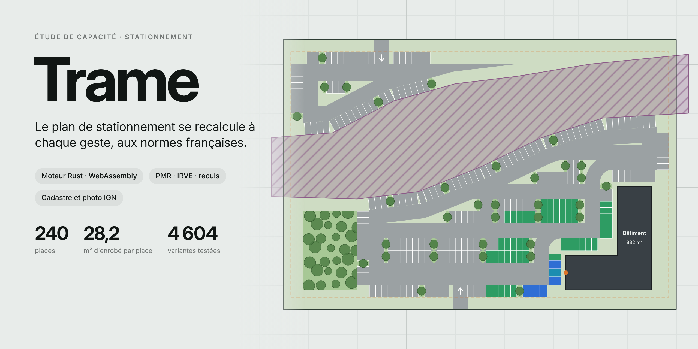

# Trame



**[Ouvrir l'application](https://ninjathune-human.github.io/parkimo/)**

Étude de capacité de stationnement en temps réel, dans l'esprit de TestFit, adaptée aux règles françaises.
Moteur en Rust compilé en WebAssembly, interface en un seul fichier `index.html` (PC, iPad, iPhone, tactile et stylet).

## Ce que fait le moteur

Un pipeline unique, rejoué à chaque mouvement de poignée :

1. **Parcelle et reculs par limite** : chaque arête a son propre recul (`setbacks[i]`), calculé comme ensemble des points à moins de *s<sub>i</sub>* de l'arête.
2. **Obstacles** : servitudes, bâtiments (avec trottoir), espaces verts imposés sont soustraits. Résultat : la zone stationnable **B**.
3. **Places en bordure** : on longe chaque bord de B, droit ou courbe, en posant des places perpendiculaires au bord local. Les angles saillants sont dégagés par une longueur calculée (`d·cot(β/2)` et zone de manœuvre pour les angles aigus).
4. **Anneau de circulation** : B érodée de la profondeur de place. Toute chaussée plus étroite que l'allée (pointes en impasse dans les angles aigus, effilements) est retirée par une ouverture morphologique, sauf l'aire de manœuvre devant les places ; les angles saillants de la chaussée sont arrondis.
5. **Rangées doubles au cœur** : B érodée de (place + allée), remplie de rangées dos à dos. L'optimiseur teste l'orientation (directions des limites et balayage tous les 3°) et le décalage de la trame (pas de 0,25 m), puis affine autour des meilleures solutions : environ 4 000 à 5 000 variantes par calcul.
6. **Découpe exacte** : îlots plantés répartis régulièrement et alignés sur les deux demi-rangées, îlots d'extrémité, allées transversales là où le concepteur a tracé une traverse (plus aucune coupure automatique).
   Tout espace résiduel de la zone stationnable (angles, têtes de rangée en biais, interstices entre places) devient un espace planté, réuni aux îlots d'extrémité et de bordure : même teinte, calque Îlots plantés, calque AutoCAD `PRJ_ILOTS`. Pour faciliter la giration, tous les angles saillants tournés vers la chaussée sont arrondis au rayon de 1 m (moins si les côtés sont courts), la chaussée reprenant l'arrondi ; les filets et décrochés de quelques centimètres laissés par les opérations booléennes (rangées légèrement en biais) sont résorbés avant ; un angle contre une place reste vif, si bien que les bandes plantées entre deux places sont rectangulaires.
7. **Accès et connectivité** : rasterisation de la voirie à 0,5 m et propagation depuis les accès ; toute place sans accès est retirée et signalée.
   Entrée de parking : de chaque côté de l'accès, là où il débouche sur l'allée, un arrondi de 3 m de rayon facilite la giration ; les places en bordure sont repoussées au-delà de ce rayon.
8. **PMR et IRVE** : groupes de 4 places remplacés par 3 places PMR de 3,30 m au plus près de l'entrée du bâtiment ; places IRVE pré-équipées (gaines, 20 %) marquées, dont au moins une PMR, et parmi elles les places équipées d'une borne (1 par tranche de 20 places), la PMR d'abord, repérées par un point au fond de la place.
9. **Circulation et signalisation horizontale** : voir ci-dessous.

Temps de calcul mesurés (WebAssembly, Chromium) : 2 à 12 ms en mode direct pendant un glisser, 12 à 40 ms pour l'optimisation complète au relâchement. Le retrait des pointes et l'analyse de circulation ne sont faits qu'au relâchement.

## Circulation et signalisation horizontale

Le moteur reconstitue le fonctionnement du parking du point de vue de l'automobiliste, puis peint les flèches au sol (`src/circulation.rs`).

1. **Réseau des voies** : la chaussée (anneau, allées, allées transversales, accès) est tramée à 0,5 m ; une transformée en distance exacte donne la largeur locale, un amincissement donne les axes. Les axes forment un graphe de carrefours, d'impasses et d'accès ; les éperons d'angle sont élagués.
2. **Logique de circulation** : on entre par un accès, on parcourt les allées pour trouver une place, on ressort par un accès. Une voie d'au moins 5,00 m est à **double sens** (NF P 91-120 ; 5,50 m en NF P 91-100). Une impasse, ou un passage obligé comme un accès unique, reste à double sens même étroit : il faut pouvoir en ressortir (signalé dans le bilan). Les autres voies étroites passent à **sens unique**, orientées pour que chaque voie soit atteignable depuis la rue et que l'on puisse toujours regagner la rue (orientation fortement connexe), en tournant de préférence dans le sens anti-horaire, comme sur un giratoire. Avec plusieurs accès étroits, certains deviennent des entrées et d'autres des sorties.
3. **Flèches au sol** : flèche **double** sur une voie à double sens (une flèche par file, circulation à droite), flèche **simple** au centre d'une voie à sens unique. Une seule flèche (ou une seule paire en double sens) par artère, au centre de l'arête du squelette, décalée au besoin sur une partie droite ; une flèche n'est posée que sur une partie droite, entièrement dans la chaussée, sans chevaucher une autre.

Avec les allées de 6,00 m par défaut, tout le parking est à double sens. Régler la largeur d'allée sous 5,00 m dans Paramètres produit un plan à sens unique.

**Squelette des voies** (interrupteur du menu Modifier) : les axes du réseau s'affichent sur le plan, en double trait pour une voie à double sens, en trait simple fléché pour une voie à sens unique. Au milieu de chaque voie (d'un carrefour au suivant), une pastille porte deux boutons : le **sens de parcours**, que l'on inverse d'un toucher sur une voie à sens unique, et le **nombre de voies** (2 ⇄ 1). Quand des voies parallèles sont proches, la pastille glisse un peu le long de la voie ; trop courte à l'écran, une voie n'en a pas (zoomer). Le choix est enregistré dans le projet (annuler, rétablir, export) par un repère que le moteur recale à chaque calcul sur le milieu de la voie, avec son sens de parcours. Les sens uniques imposés sont orientés avant ceux des voies étroites, du plus ancien au plus récent, avec la même règle de connexité : un sens unique, ou un sens de parcours, qui couperait la circulation (impasse, passage obligé) est refusé et le plan reste inchangé. Une voie étroite sans consigne prolonge de préférence le sens d'une voie alignée.

**Estimation des travaux** (menu Estimation) : montant global au ratio, d'après le nombre de places du plan et un barème de parkings de surface de la métropole niçoise (€ HT par place, travaux seuls puis avec études et maîtrise d'œuvre) : 20 à 50 places 2 300 à 3 800 € (2 700 à 4 400 €) ; 50 à 150 : 2 000 à 3 200 € (2 350 à 3 700 €) ; 150 à 300 : 1 800 à 2 800 € (2 100 à 3 250 €) ; 300 à 600 : 1 600 à 2 500 € (1 850 à 2 900 €) ; 600 à 1 000 : 1 500 à 2 300 € (1 750 à 2 650 €). La tranche est celle qui contient le nombre de places (à 50 places, la tranche inférieure) ; hors barème, la tranche extrême s'applique. Les ratios sont modifiables dans le menu (le barème est enregistré dans le navigateur, hors projet ; « Barème d'origine » le rétablit). Le montant se met à jour à chaque calcul. Estimation d'avant-projet, hors foncier et aléas de site.

**Traverses** (menu Modifier, affichées avec le squelette des voies) : un segment tracé par le concepteur coupe les rangées en allées transversales à la largeur de l'allée. On déplace ses deux extrémités (poignées rondes), et la croix, au milieu, la supprime. Les créneaux retirés suivent la traverse rangée par rangée ; une traverse parallèle aux rangées n'en coupe aucune. Elles sont enregistrées dans le projet (annuler, rétablir). Le réglage « Rangée continue maximale » n'existe plus.

**Squelette des noues** (second interrupteur du menu Modifier) : une barre symbolique s'affiche dans l'axe de chaque noue, avec une pastille en son milieu. Un toucher sur la pastille (croix) **supprime** la noue : son figuré disparaît, la rangée se referme (les deux demi-rangées se touchent), les rangées au-dessus se rapprochent d'autant et de nouvelles places prennent la place libérée, pour garder un maximum de places. La suppression vaut pour toute la rangée (tous ses tronçons). La noue n'est plus exportée en DXF. La barre devient alors **rouge** et reste visible dans le squelette ; la pastille (flèche de retour) la **rétablit**. Le choix est enregistré dans le projet (annuler, rétablir) par un repère (`noue_off`, milieu de l'axe) que le moteur recale à chaque calcul sur la noue qu'il touche (`noues_off` en sortie).

**Largeur voie en sens unique** (5,00 m par défaut : places à 90°, NF P 91-100) : une voie passée à sens unique prend cette largeur.
- Allée entre deux rangées : elle se resserre et les rangées voisines s'en rapprochent chacune de la moitié de l'écart ; la trame (orientation, décalage) reste celle du plan optimisé, puis glisse d'au plus 2 m pour tirer parti de la place libérée.
- Côté droit de l'anneau perpendiculaire aux rangées : le cœur avance, les rangées s'allongent.
- Côté droit de l'anneau parallèle aux rangées, en bord de trame : la trame se cale pour que la rangée la plus proche affleure la voie resserrée.
- Tronçon oblique ou courbe, allée transversale, raccord : la voie passe à sens unique sans changer de largeur.

Calque **Sens de circulation** dans la couche Projet ; à l'export, bloc `SIG_FLECHE` sur le calque `PRJ_SIGNALISATION`.

## Interface

- **Barre d'outils** : **Nouveau** (projet vierge, Carte IGN, Tracer une parcelle, retour à « Mon site »), puis **Paramètres**, **Ajouter**, **Modifier** (squelettes des voies et des noues, orientation des rangées, traverses), **Habillage**, **Estimation** et **Exporter**, et enfin annuler / rétablir.
- **Colonne de gauche** : le bilan en haut, les couches en bas ; les couches cèdent la hauteur qui manque et défilent. Sur téléphone, les deux panneaux sont repliés en haut et un seul s'ouvre à la fois.
- **Limites de la parcelle** : au survol d'un bord (ou en le touchant sur tablette), deux boutons apparaissent en son milieu, alignés sur le segment : **+** ajoute un sommet, **arc** arrondit le segment ou le redresse. Un segment arrondi est un vrai arc de cercle (flèche mémorisée en fraction de la corde) : on règle la courbure en glissant la poignée située au-delà de son sommet, et l'arc suit le déplacement des sommets. Seul le moteur et l'export DXF reçoivent un contour discrétisé (un côté tous les 4° environ). Ajouter un sommet sur un arc le coupe en deux arcs du même cercle. Les mêmes boutons, la même poignée (visible tant que l'objet est sélectionné ; un clic dans le vide ou Échap désélectionne et masque poignées et boutons) et les mêmes arcs valent pour les segments des servitudes, des espaces verts imposés et des bassins (la flèche est portée par le sommet : `[x, y, k]`). Le long d'une courbe, les places périphériques sont des trapèzes : un seul trait, porté par la normale locale de la limite, sépare deux places voisines, sans interstice ni chevauchement. Quand la limite est bombée (les places se resserrent vers l'allée), le fond s'élargit pour que l'entrée de chaque place garde au moins la largeur demandée.
- **Bassin de rétention** (menu Ajouter ; traits fins et peu contrastés, comme les noues) : zone verte en creux, sans stationnement, éditable comme un espace vert (sommets, arcs, déplacement). Il se représente en topographie : haut de talus (trait fort, le contour du polygone), pied de talus (trait fin, fond plus sombre) à 3 × la hauteur du haut de talus (talus 3 pour 1, réduit si le bassin est étroit) et barbules du haut vers le bas, alternativement longues et courtes. La hauteur se règle dans Paramètres (« Hauteur bassin de rétention », 1,50 m par défaut). Une bande de verdure d'accès et d'entretien de 2 m (réglable, « Verdure autour du bassin ») entoure le haut de talus : aucune place n'y est tracée. Export DXF : calques `PRJ_BASSIN_TALUS_HAUT` et `PRJ_BASSIN_TALUS_BAS` (sans barbules).
- **Entrée des bâtiments** : chaque bâtiment porte une entrée (barre sur son pourtour, largeur réglée dans Paramètres, cheminement à travers le trottoir). Devant l'entrée, un couloir libre de la largeur de l'entrée est réservé : ni place de stationnement ni espace vert n'y est tracé (profondeur : trottoir, plus la profondeur de place si le périmètre est activé). Un avertissement s'affiche si une servitude ou un espace vert posé par l'utilisateur l'obstrue. Le reste de place le long de la limite est réparti à égalité de part et d'autre du couloir (même jeu des deux côtés, sans perdre de place), et les espaces verts qui le bordent ne reçoivent jamais d'arrondi de giration. Glissez sa poignée le long du contour pour la placer ; par défaut, elle est sur l'arête la plus proche du premier accès véhicules. Elle suit le bâtiment qu'on déplace, tourne ou redimensionne, et sert de cible aux places PMR.
- **Bouton de cadrage et échelle** en haut à droite (en bas à droite sur téléphone et sur la carte).

## Fond de carte IGN

Bouton **Carte** : recherche d'un lieu (adresse, commune, lieu-dit, référence cadastrale comme `06088000KY0116` ou `06088 KY 116`, coordonnées GPS), puis **Emprise** pour poser un rectangle ajustable et **Importer**.

- La photo aérienne (ORTHOIMAGERY.ORTHOPHOTOS, jusqu'au niveau 19, environ 0,2 m par pixel) est assemblée puis **découpée au rectangle** : seule cette image est conservée.
- Les données cadastrales du Parcellaire Express (WFS, pagination par 1 000 objets) sont converties dans le repère local du plan et forment des **couches**. Chaque élément affichable ou masquable d'une couche est un **calque**, avec son interrupteur : parcelles, numéros, feuilles et sections, limites communales.
- **Occupation du sol**, calculée en Rust dans l'emprise : le bâti (cadastre), la voirie (domaine non cadastré : l'emprise moins les parcelles), et tout le reste en **végétation**, représentée par une trame verte. Ce sont de vrais polygones (avec trous, par exemple les cours intérieures), au même titre que le bâti.
- Toucher une parcelle puis **Étudier** en fait la parcelle d'étude ; **Ajouter à l'étude** la réunit à la précédente (union calculée en Rust).
- Le fond est enregistré dans le navigateur (IndexedDB) et revient au rechargement.

Services utilisés (Géoplateforme, sans clé) : `data.geopf.fr/wmts`, `data.geopf.fr/wfs/ows`, `data.geopf.fr/geocodage/search`.
Une page publiée sur claude.ai ne peut pas joindre ces services : le fond de carte fonctionne avec `dist/index.html`, en local ou sur GitHub Pages.

## Habillage

Bouton **Habillage** : un menu dédié à la présentation du plan, sans effet sur le calcul.

- **Véhicules** : un curseur règle la part des places occupées (0 à 100 %). Six gabarits vus de dessus, tirés au hasard selon leur fréquence : citadine, compacte, berline, break, SUV, utilitaire. Teintes du parc automobile, entrée en marche avant le plus souvent, léger décalage dans la place ; un véhicule ne déborde jamais de sa place.
- **Arbres** : une essence pour tout le plan (feuillu, pin parasol, olivier, palmier, conifère) ou un mélange, dans les îlots plantés et, en quinconce, dans les espaces verts imposés. Rotation et taille légèrement variées.
- **Nouveau tirage** redistribue véhicules et essences. Le tirage est stable : il ne change pas d'un affichage à l'autre.
- Couche **Habillage** dans le panneau des couches : calques Véhicules et Arbres.

Les symboles ont une seule source, `src/symbols.json` (générée par `tools/symbols.py`) : l'application les dessine et l'export DXF les insère comme blocs AutoCAD du même dessin.

## Places inclinées (épis)

Menu **Modifier**, « Inclinaison des places » : 90° (défaut), 75°, 60°, 45° ou 30° (paramètre moteur `slant`), pour les rangées intérieures et pour les places de bordure.

- **Place** : le rectangle largeur × longueur du réglage, pivoté de l'angle. Pas le long de l'allée `largeur / sin(angle)`, profondeur perpendiculaire `longueur × sin(angle) + largeur × cos(angle)` (4,67 m à 30°, 5,30 m à 45°, 5,58 m à 60°, 5,48 m à 75° pour 2,50 × 5,00). Neufert cote des profondeurs plus courtes à 45° et 60° (convention de débord sur bordure) : le moteur garde la géométrie du rectangle.
- **Voies** : largeur de voie de Neufert p. 272 selon l'angle et la largeur de place (interpolée entre 2,30 et 2,50 m) : 75° 5,00 m, 60° 4,00 m, 45° 3,00 m, 30° 3,00 m pour des places de 2,50 m. Le réglage « Largeur d'allée » ne vaut plus que pour l'anneau et le 90°. La voie sert alors de sens unique : les allées voisines sont parcourues en sens inverses, et chaque rangée double s'incline vers le sens de l'allée qu'elle borde (les sens sont imposés à l'analyse de circulation ; les repères du concepteur restent prioritaires). Une allée en impasse ne peut pas être à sens unique : elle est signalée.
- **Calcul** : chaque rangée double est étudiée dans un repère cisaillé où ses places redeviennent des rectangles ; les deux pentes alternent d'une rangée à l'autre. Les extrémités de rangée laissent des triangles, plantés.
- **Bordure** : chaque place est un parallélogramme dont le fond suit la limite (corde de `largeur / sin(angle)`) et dont l'avant est reculé de `profondeur × cotan(angle)` contre le sens de la limite. L'anneau devient une voie à sens unique de la largeur Neufert, parcourue dans le sens de la limite (les places restent à droite de la voie : anti-horaire sur le pourtour, horaire autour d'un bâtiment) ; ces sens sont imposés à l'analyse de circulation, sans repère visible. L'aire de manœuvre devant chaque place de bordure reste chaussée, et les rangées intérieures évitent les places de bordure et leur aire de manœuvre. Les accès, les cheminements devant les portes et la bande de bordure prennent la profondeur inclinée.
- **Effet sur le nombre de places** (scénario « rect », 302 places à 90°) : 295 à 75°, 279 à 60°, 251 à 45°, 184 à 30°. La bordure perd le plus (112 places à 90°, 107, 91, 72 puis 49) ; l'intérieur reste stable car l'anneau plus étroit libère de la profondeur.

## Export tableur (XLS)

Menu **Exporter**, bouton « Télécharger le tableur XLS » : classeur XML Spreadsheet 2003 (`.xls`, lu par Excel, LibreOffice et Numbers, sans bibliothèque). Feuille **Synthèse** : projet (dates de création et de dernière modification, conservées dans le navigateur avec le projet), emplacement (commune, références cadastrales, latitude et longitude WGS84 du centre de la parcelle), places (total, standard, PMR, IRVE, bordure et cœur, conformités, parts), arbres, surfaces et ratios (enrobé, espaces verts, m² par place, places par hectare), hypothèses de calcul et estimation financière (tranche, ratios, totaux mini, maxi et central, avec ou sans études et MOE). Feuille **Barème** : le barème en vigueur et la tranche appliquée.

## Export DXF

Bouton **Exporter** : fichier DXF AutoCAD 2010 (texte UTF-8), unités en mètres, au choix en **RGF93 / Lambert-93** (EPSG:2154) ou en **RGF93 / CC** de la zone du site (EPSG:3942 à 3950, CC44 à Nice).

- Chaîne de coordonnées : repère local → Web Mercator → RGF93 géographique → conique conforme de Lambert sur l'ellipsoïde GRS80. Projections vérifiées contre PROJ à moins d'un millimètre ; sommets cadastraux restitués au centimètre.
- Un calque AutoCAD par calque de l'application ; les calques masqués sont exportés éteints. Le cadastre est limité à l'emprise.
- Entités : `LWPOLYLINE` (contours), `HATCH` (trames : végétation, bâti, servitudes, places PMR), `TEXT` (numéros de parcelle, sections, cartouche), `INSERT` du bloc de marquage `SIG_FLECHE` et des blocs d'habillage : `VEH_CITADINE`, `VEH_COMPACTE`, `VEH_BERLINE`, `VEH_BREAK`, `VEH_SUV`, `VEH_UTILITAIRE`, `ARB_FEUILLU`, `ARB_PIN`, `ARB_OLIVIER`, `ARB_PALMIER`, `ARB_CONIFERE`. Les blocs sont dessinés en vraie grandeur (véhicules) ou au rayon unitaire (arbres, insérés à l'échelle du houppier), sur le calque 0 en couleur DUBLOC ; leur orientation tient compte de la convergence des méridiens.

| Couche | Calques AutoCAD |
|---|---|
| Projet | `PRJ_PARCELLE`, `PRJ_RECUL`, `PRJ_VOIRIE`, `PRJ_SIGNALISATION`, `PRJ_RAMPES`, `PRJ_GIRATIONS`, `PRJ_PLACES`, `PRJ_PLACES_PMR`, `PRJ_PLACES_IRVE`, `PRJ_PLACES_IRVE_EQ`, `PRJ_ILOTS`, `PRJ_NOUES`, `PRJ_BATIMENTS`, `PRJ_ESPACES_VERTS`, `PRJ_BASSIN_TALUS_HAUT`, `PRJ_BASSIN_TALUS_BAS`, `PRJ_SERVITUDES` |
| Habillage | `HAB_VEHICULES`, `HAB_ARBRES` |
| Occupation du sol | `OCC_VOIRIE`, `OCC_BATI`, `OCC_VEGETATION` |
| Cadastre | `CAD_PARCELLES`, `CAD_NUMEROS`, `CAD_FEUILLES`, `CAD_COMMUNES` |
| Repères | `EMPRISE`, `INFO` (système de coordonnées, sources, bilan) |

Le squelette du fichier (en-tête, tables, calques, types de ligne, blocs) est produit par ezdxf (`tools/dxf_template.py`) ; chaque export est relu par ezdxf dans les tests, sans erreur d'audit.

## Parking en ouvrage (Silo, lot 1)

Menu **Paramètres**, « Type d'étude » : Surface ou **Silo**. Le lot 1 dessine le plateau dans la zone constructible ; le lot 2 ajoute les niveaux et les rampes droites ; les noyaux (escaliers, ascenseurs) et la maquette IFC à plusieurs niveaux suivent.

- **Module** : place + allée + place (2 × 5,00 + 6,00 = 16,00 m avec les réglages par défaut), places à 90° seulement, 3 places au plus entre poteaux (réglable) : les travées d'une rangée sont réparties également, elles diffèrent d'une place au plus et chaque file tombe sur une séparation de places (16 places : 3, 2, 3, 3, 2, 3 au lieu de 3, 3, 3, 3, 4). Rangées de pignon et allées transversales si la dalle le permet (« Places le long des pignons ») : les places de pignon se calent contre les files intérieures, le reste part contre les façades, et une file de poteaux en tête de ces places coupe la portée entre la façade et le début des rangées.
- **Niveaux et rampes** (Paramètres : « Niveaux », « Pente des rampes », « Rampes ») : au-delà d'un niveau, deux rampes droites à sens unique, montée depuis un bout, descente depuis l'autre, superposées d'un niveau à l'autre. Implantation **en rangée** (le long des allées, au début d'une rangée de façade, voie contre l'allée ; deux modules au moins), **en pignon** (en travers des allées, dans la bande de pignon contre l'allée transversale ; trois modules au moins), en **hélice** (deux tours hélicoïdales à sens unique, montée à un bout, descente à l'autre, un tour par niveau ; gabarit Neufert de la rampe courbe à une voie : mur intérieur R 4,00, voie de 4,00 m entre R 5,00 et R 9,00, bordure R 9,50 ; porte de chaque niveau tangente à la voie ouest de l'allée transversale ; trois modules au moins ; bande d'extrémité de 21,80 m, places de pignon contre l'allée transversale ; pente dans l'axe de la voie, 6,6 % pour 2,90 m d'étage) ou en **demi-niveaux** (deux demi-plateaux d'un module décalés d'un demi-étage, joint de 0,50 m, reliés à chaque bout par une demi-rampe en U à double sens : voie intérieure de 3,50 m au rayon extérieur 8,50 m pour monter, voie extérieure de 3,00 m pour descendre, NF P 91-100 § 3.3 ; allées à double sens, circulation à droite ; pente dans l'axe de la voie intérieure, 6,8 % pour 2,90 m d'étage ; zone d'extrémité de 11,80 m sans places de pignon ; chaque niveau compte deux demi-plateaux) ; **Auto** construit les quatre et garde celle qui laisse le plus de places par niveau courant ; la recherche de dalle fait passer les emprises où les rampes tiennent avant les autres. Voie de 3,25 m (2,75 + 2 × 0,25, Neufert p. 274-276 ; NF P 91-100 : 3,00 au moins). Longueur horizontale L = h / p + (10 + 15) × p / 2 (pente ≤ 18 %, raccords R 10 en sommet et R 15 en pied, NF P 91-100 § 3.4) : 18,36 m pour 2,90 m d'étage à 18 %.
- **Girations** (calque « Girations des rampes ») : épure de chaque entrée et sortie de rampe au gabarit de la NF P 91-100 § 3.3 (voie de 4,00 m en courbe, rayon extérieur 8,50 m ; 3,00 m en ligne droite ; trajectoire au milieu de la voie, rayon 6,50 m). Entrée en rangée : depuis une autre allée, deux quarts de tour par l'allée transversale ; sortie en S dans l'allée voisine. En pignon : un quart de tour depuis l'allée la plus éloignée, un autre vers l'allée opposée. Une épure qui touche un poteau, l'autre rampe ou une façade est dessinée en rouge et signalée. Places et poteaux retirés dans l'emprise des rampes (poutres aussi) ; poteaux retirés aussi aux abords de la voie ; places des épures retirées seulement aux niveaux où l'épure sert (extrémité basse : tous sauf le dernier ; haute : tous sauf le rez). Au dernier niveau, la montée qui arrive laisse une trémie. Le plan montre un niveau courant ; le bilan donne les places au rez, par niveau courant, au dernier et au total. Autres contrôles : hauteur libre perpendiculaire à la rampe (2,00 m plus la flèche du raccord de sommet, sous le plancher du dessus). Calques DXF `PRJ_RAMPES` (voie, axe fléché, « Montée 18 % ») et `PRJ_GIRATIONS` (contour et trajectoire). Corpus des types de rampes, exemples et conditions : `docs/corpus-rampes.md`. La maquette IFC reste à un niveau (niveau courant) pour l'instant.
- **Portée** (densité de la trame en travers des allées, Paramètres) :
  - **Longue** : poteaux en façade et en dos à dos, dans le premier 1,10 m du fond de place (NF P 91-100, fig. 2 : largeur au droit de l'obstacle ≥ 2,00 m) ; portée d'un module (15,70 à 16,00 m).
  - **Moyenne** : poteaux en tête des deux rangées de chaque dos à dos (11,65 / 8,10 / 11,65 m pour deux modules).
  - **Courte** : poteaux en tête de chaque rangée, de part et d'autre de chaque allée (8,10 m au plus) ; plancher-dalle envisageable.

  En tête de place, le nu du poteau est à « Retrait en tête de place » du bord de l'allée : 0,65 m par défaut, minimum sans surlargeur (NF P 91-100, tab. 3), et le poteau reste entier dans les 1,25 m côté allée pour garder libre la zone des portières (Neufert p. 274). Le bilan signale un retrait plus faible ou un poteau qui sort de cette bande, et affiche la portée en travers. Plateau de 32,40 × 60 m : 84 places en portée longue, 82 en moyenne et en courte (une place de pignon de moins par façade).
- **Emprise** : recherche du plus grand plateau rectangulaire inscrit (trame 0,50 m, orientations des limites et tous les 3°) qui maximise le nombre de places. Un angle imposé dans Modifier est respecté.
- **Édition de la dalle** : toucher la dalle la sélectionne. Glisser à l'intérieur la déplace ; la pastille ronde la fait tourner (aimantée au degré et aux directions des limites) ; les barrettes au milieu des côtés l'étirent, côté opposé fixe, par modules entiers en travers et par places entières en long. « Tourner les allées » garde l'emprise et passe les allées à 90° ; « Emprise automatique » revient à la recherche. Une dalle dessinée peut sortir des reculs : le bilan le signale.
- **Système constructif** (Paramètres, au-dessus de la portée) : il fixe le plancher, ses produits et sa retombée (`src/ouvrage/systemes.rs`, chaque valeur avec sa source). Choisir un système applique ses valeurs par défaut (poteau, largeur de place).

  | Système | Longue | Moyenne | Courte |
  |---|---|---|---|
  | Béton coulé en place | dalle post-contrainte allégée 40 cm, sans retombée (silo République, Reims) | poutres BA en travers h = L/15 et dalle pleine e = L/30 (BAEL 91) | plancher-dalle, 22 à 35 cm pour 8 à 12 m (interpolé) |
  | Préfabriqué béton | dalles alvéolées 1,20 m + compression 5 cm sur poutres précontraintes à retombée ≤ 15 cm : plus petite dalle NERVA (Rector) dont la portée courante (portée maximale / 1,4, rapport des FDES) couvre la portée ; places de 2,40 m (2 dalles) | idem | idem |
  | Mixte acier-béton | dalle mixte 14 cm sur bac collaborant, solives sur les files de poteaux : IPE 400 à 2,50 m, IPE 550 à 5,00 m (ArcelorMittal, Car parks in steel ; AFGC 2017) ; 2 places au plus entre poteaux par défaut ; poteaux HEA 180 (parking CHL, Luxembourg) | non prévu | non prévu |

  Hauteur d'étage minimale : 2,20 m sous plafond et 2,00 m sous poutre (NF P 91-100, § 3.2), plus l'épaisseur et la retombée du plancher ; le bilan l'affiche et signale une hauteur d'étage plus faible. Avertissements : travée qui n'est pas un multiple de 1,20 m en préfabriqué (dalles à démoduler), portée hors gamme ou au-delà de la portée courante, acier-béton hors portée longue ou à plus de 4 places entre poteaux. Les portées sont des entraxes de files (valeur sûre).

  **Poutres et solives**, de poteau à poteau : en travers des allées sur chaque file transversale (béton coulé en portée moyenne, section 0,4 h × h ; acier-béton, solives IPE), ou le long des allées sur chaque file longitudinale (préfabriqué, poutres en T renversé 110 × 45 cm, retombée 15 cm, 10 m au plus). Dessinées en tirets dans le calque Structure (elles sont sous la dalle), calque DXF `STR_POUTRES`, `IfcBeam` dans la maquette (`JOIST` pour les solives), de la hauteur de la retombée sous la toiture, types nommés par profil (`PKM_Poutre_BA_32x78`, `PKM_Poutre_PP_T_110x45`, `PKM_Solive_IPE550`). Avertissements : solives à plus de 5,00 m (hors guide), bac à étayer au-delà de 5,00 m aux extrémités, poutres précontraintes au-delà de 10 m.
- **Trame** : axes repérés 1, 2, 3… et A, B, C… ; dalle, poutres, poteaux et axes forment le calque « Structure ». Hauteur d'étage, plancher, sections de poteaux et rive de façade sont des hypothèses d'esquisse à confirmer par le bureau d'études et le fabricant.
- **Normes** (`src/ouvrage/normes.rs`) : valeurs NF P 91-100, Neufert, PS (arrêté du 25 juin 1980), accessibilité, chacune avec sa source ; longueurs de rampe et flèches de raccordement calculées.
- **DXF** : calques `STR_DALLE`, `STR_POUTRES`, `STR_POTEAUX`, `STR_AXES`, `STR_REPERES`.
- **Maquette IFC** (menu Exporter, « Télécharger la maquette IFC ») : IFC4 (ISO 16739-1:2018), écrite par le moteur Rust. Structure spatiale Projet / Site / Bâtiment / Niveau ; `IfcSlab` (dalle et toiture), `IfcColumn`, `IfcBeam`, `IfcSpace` PARKING pour chaque place et chaque allée (`Pset_SpaceParking`), `IfcGrid` de la trame ; types partagés nommés par produit (`PKM_Plancher_DAP_NSC27+5`, `PKM_Poteau_Acier_17x18`, `PKM_Poteau_BA_30x60`…) et propriétés `PKM_Stationnement`. Identifiants stables d'un export à l'autre (dérivés du repère de chaque élément). Géoréférencement `IfcMapConversion` en Lambert-93 ou CC quand le site est sur fond de carte. Contrôle : `python3 tools/check_ifc.py fichier.ifc` (ifcopenshell, règles EXPRESS). Import Revit non encore vérifié.

## Valeurs par défaut

| Paramètre | Valeur | Source |
|---|---|---|
| Place | 2,50 × 5,00 m | usage courant PLU (minimum NF P 91-100 : 2,30 × 5,00) |
| Verdure autour du bassin | 2,00 m | bande verte d'accès et d'entretien autour du haut de talus, sans stationnement |
| Hauteur bassin de rétention | 1,50 m | talus 3 pour 1 : pied de talus à 3 × la hauteur du haut de talus |
| Noue entre rangées | aucune (0) ; 1 à 6 m | bande plantée entre les deux demi-rangées dos à dos de chaque rangée double ; elle allonge la période des rangées de sa largeur, reste un espace vert et est interrompue par les allées transversales et s'arrête là où le cœur s'arrête (elle ne déborde jamais sur la chaussée) ; elle est figurée en haricot allongé aux bouts arrondis (haut de talus en trait fort, barbules courtes de longueurs alternées vers l'intérieur, fond en un seul trait) et exportée sur le calque `PRJ_NOUES` ; une valeur entre 0 et 1 m équivaut à aucune noue, au-delà de 6 m à 6 m |
| Largeur d'allée | 6,00 m, double sens | usage courant PLU ; double sens à partir de 5,00 m (NF P 91-120, 5,50 m en NF P 91-100), sens unique en dessous |
| Largeur voie en sens unique | 5,00 m | NF P 91-100, places à 90° (2,80 m minimum pour une voie de circulation en NF P 91-120) |
| Largeur de l'entrée | 6,00 m | accès véhicules ; réglable (usage courant : 3,00 m minimum en sens unique, 5,00 à 6,00 m à double sens) |
| Largeur d'entrée du bâtiment | 3,00 m | seuil et couloir libre devant l'entrée (largeur) ; réglable |
| Place PMR | 3,30 × 5,00 m, 2 % (min. 1) | arrêté du 20 avril 2017 (ERP) |
| IRVE | 20 % pré-équipées, dont 2 % PMR (min. 1) | CCH L111-3-4, non résidentiel neuf |
| IRVE équipées | 1 point de charge par tranche de 20 places (5 %, min. 1), dont une PMR ; réglable | parkings de plus de 20 places, non résidentiel ouvert au public |

Tout est réglable dans le panneau Paramètres. À vérifier selon le PLU et la destination du projet.

## Structure

```
src/geom.rs       vecteurs, quadrilatères, régions pair-impair, intervalles de bande exacts
src/region.rs     reculs par arête, obstacles, érosions (booléens robustes via la crate geo)
src/perimeter.rs  places en bordure, bords droits et courbes
src/rows.rs       optimisation orientation × décalage, découpe des rangées doubles, allées resserrées
src/finish.rs     connectivité depuis les accès, PMR, IRVE
src/circulation.rs réseau des voies, sens de circulation (typologies imposées comprises), flèches au sol
src/planted.rs    espaces plantés, arrondis en bordure de chaussée
src/occupation.rs occupation du sol : voirie, bâti, végétation
src/proj.rs       projections Lambert-93 et CC (RGF93, GRS80)
src/dxf.rs        export DXF AutoCAD 2010 géoréférencé
src/ouvrage/      parking en ouvrage : normes sourcées, plateau et densité de trame, systèmes constructifs, modèle BIM, écriture IFC4
src/dxf_template.dxf squelette AutoCAD (calques, types de ligne, blocs d'habillage)
src/symbols.json  symboles d'habillage (véhicules, arbres) et flèche au sol, partagés par l'interface et l'export
src/lib.rs        orchestration, union de parcelles, interface WebAssembly (JSON en entrée, JSON en sortie)
tests/quality.rs  invariants : aucun chevauchement, aucune place hors zone ou sans accès, quotas, 60 parcelles aléatoires,
                  flèches dans la chaussée, sens unique fortement connexe, bascule des voies par le squelette,
                  voies resserrées à la largeur sens unique, repères stables, sens de parcours imposé
examples/dxf.rs   export d'un scénario en DXF
examples/ifc.rs   export d'un scénario en IFC (scenarios/silo.json)
tests/ouvrage.rs  plateaux sans chevauchement ni poteau dans les allées (trois densités), identifiants stables, export IFC
tools/check_ifc.py validation d'un fichier IFC (ifcopenshell)
web/app.html      interface (canvas, poignées, panneaux, mode carte, couches et calques, export)
tools/bundle.py   assemble dist/index.html avec le moteur embarqué
tools/wrap_w2j.py repli JavaScript du moteur (wasm2js)
tools/symbols.py  génère src/symbols.json
tools/dxf_template.py génère src/dxf_template.dxf (ezdxf) avec les blocs de src/symbols.json
```

## Compiler

```sh
rustup target add wasm32-unknown-unknown
cargo test --release          # invariants de qualité
./build.sh                    # produit dist/index.html (wasm-opt utilisé s'il est installé)
```

Ouvrir `dist/index.html` dans un navigateur, ou le publier tel quel sur GitHub Pages.

Scénarios de contrôle : `cargo run --release --example run -- scenarios/ruisseau.json sortie.json`, puis `python3 tools/render.py sortie.json plan.png`.

**Sélection et suppression** : un élément sélectionné (sommet, accès, bâtiment, espace vert, bassin, zone non aedificandi) porte une petite icône de suppression à proximité ; sur un sommet d'objet, elle retire ce sommet (au moins trois sommets restent), sinon l'objet entier. La barre d'actions n'apparaît plus que pour une parcelle cadastrale (Étudier, Ajouter à l'étude) et un bâtiment (forme en L, pivoter). Toutes les icônes, sur le plan comme dans les menus, ont la taille de celle des accès (18 px).

**Boutons d'un segment** (survol ou toucher d'un contour) : « + » ajoute un sommet au milieu, le **rond** du centre déplace le segment entier en le glissant (ses deux sommets suivent, les autres restent), et le dernier bouton arrondit un segment droit (icône d'arc) ou redresse un segment courbe (icône de ligne, bouton plein).
