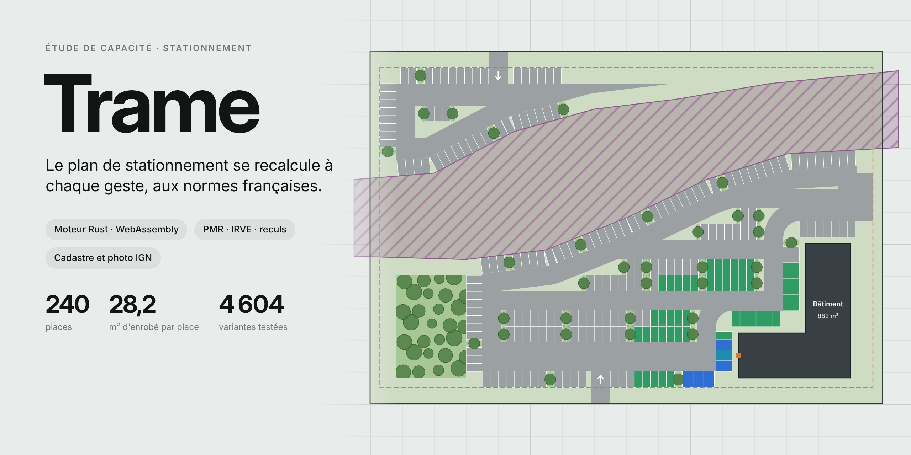

# Trame



**[Ouvrir l'application](https://ninjathune-human.github.io/parkimo/)**

Étude de capacité de stationnement en temps réel, dans l'esprit de TestFit, adaptée aux règles françaises.
Moteur en Rust compilé en WebAssembly, interface en un seul fichier `index.html` (PC, iPad, iPhone, tactile et stylet).

## Ce que fait le moteur

Un pipeline unique, rejoué à chaque mouvement de poignée :

1. **Parcelle et reculs par limite** : chaque arête a son propre recul (`setbacks[i]`), calculé comme ensemble des points à moins de *s<sub>i</sub>* de l'arête.
2. **Obstacles** : servitudes, bâtiments (avec trottoir), espaces verts imposés sont soustraits. Résultat : la zone stationnable **B**.
3. **Places en bordure** : on longe chaque bord de B, droit ou courbe, en posant des places perpendiculaires au bord local. Les angles saillants sont dégagés par une longueur calculée (`d·cot(β/2)` et zone de manœuvre pour les angles aigus).
4. **Anneau de circulation** : B érodée de la profondeur de place. Toute chaussée plus étroite que l'allée (pointes en impasse dans les angles aigus, effilements) est retirée par une ouverture morphologique, sauf l'aire de manœuvre devant les places ; les angles saillants de la chaussée sont arrondis.
5. **Rangées doubles au cœur** : B érodée de (place + allée), remplie de rangées dos à dos. L'optimiseur teste l'orientation (directions des limites et balayage tous les 3°) et le décalage de la trame (pas de 0,25 m), puis affine autour des meilleures solutions : environ 4 000 à 5 000 variantes par calcul.
6. **Découpe exacte** : îlots plantés répartis régulièrement et alignés sur les deux demi-rangées, îlots d'extrémité, allées transversales au-delà de la longueur maximale.
   Tout espace résiduel de la zone stationnable (angles, têtes de rangée en biais, interstices entre places) devient un espace planté, réuni aux îlots d'extrémité et de bordure : même teinte, calque Îlots plantés, calque AutoCAD `PRJ_ILOTS`. Pour faciliter la giration, tous les angles saillants tournés vers la chaussée sont arrondis au rayon de 1 m (moins si les côtés sont courts), la chaussée reprenant l'arrondi ; les filets et décrochés de quelques centimètres laissés par les opérations booléennes (rangées légèrement en biais) sont résorbés avant ; un angle contre une place reste vif, si bien que les bandes plantées entre deux places sont rectangulaires.
7. **Accès et connectivité** : rasterisation de la voirie à 0,5 m et propagation depuis les accès ; toute place sans accès est retirée et signalée.
   Entrée de parking : de chaque côté de l'accès, là où il débouche sur l'allée, un arrondi de 3 m de rayon facilite la giration ; les places en bordure sont repoussées au-delà de ce rayon.
8. **PMR et IRVE** : groupes de 4 places remplacés par 3 places PMR de 3,30 m au plus près de l'entrée du bâtiment ; places IRVE pré-équipées (gaines, 20 %) marquées, dont au moins une PMR, et parmi elles les places équipées d'une borne (1 par tranche de 20 places), la PMR d'abord, repérées par un point au fond de la place.
9. **Circulation et signalisation horizontale** : voir ci-dessous.

Temps de calcul mesurés (WebAssembly, Chromium) : 2 à 12 ms en mode direct pendant un glisser, 12 à 40 ms pour l'optimisation complète au relâchement. Le retrait des pointes et l'analyse de circulation ne sont faits qu'au relâchement.

## Circulation et signalisation horizontale

Le moteur reconstitue le fonctionnement du parking du point de vue de l'automobiliste, puis peint les flèches au sol (`src/circulation.rs`).

1. **Réseau des voies** : la chaussée (anneau, allées, allées transversales, accès) est tramée à 0,5 m ; une transformée en distance exacte donne la largeur locale, un amincissement donne les axes. Les axes forment un graphe de carrefours, d'impasses et d'accès ; les éperons d'angle sont élagués.
2. **Logique de circulation** : on entre par un accès, on parcourt les allées pour trouver une place, on ressort par un accès. Une voie d'au moins 5,00 m est à **double sens** (NF P 91-120 ; 5,50 m en NF P 91-100). Une impasse, ou un passage obligé comme un accès unique, reste à double sens même étroit : il faut pouvoir en ressortir (signalé dans le bilan). Les autres voies étroites passent à **sens unique**, orientées pour que chaque voie soit atteignable depuis la rue et que l'on puisse toujours regagner la rue (orientation fortement connexe), en tournant de préférence dans le sens anti-horaire, comme sur un giratoire. Avec plusieurs accès étroits, certains deviennent des entrées et d'autres des sorties.
3. **Flèches au sol** : flèche **double** sur une voie à double sens (une flèche par file, circulation à droite), flèche **simple** au centre d'une voie à sens unique. Une seule flèche (ou une seule paire en double sens) par artère, au centre de l'arête du squelette, décalée au besoin sur une partie droite ; une flèche n'est posée que sur une partie droite, entièrement dans la chaussée, sans chevaucher une autre.

Avec les allées de 6,00 m par défaut, tout le parking est à double sens. Régler la largeur d'allée sous 5,00 m dans Hypothèses produit un plan à sens unique.

**Squelette des voies** (interrupteur dans Hypothèses) : les axes du réseau s'affichent sur le plan, en double trait pour une voie à double sens, en trait simple fléché pour une voie à sens unique. Au milieu de chaque voie (d'un carrefour au suivant), une pastille porte deux boutons : le **sens de parcours**, que l'on inverse d'un toucher sur une voie à sens unique, et le **nombre de voies** (2 ⇄ 1). Quand des voies parallèles sont proches, la pastille glisse un peu le long de la voie ; trop courte à l'écran, une voie n'en a pas (zoomer). Le choix est enregistré dans le projet (annuler, rétablir, export) par un repère que le moteur recale à chaque calcul sur le milieu de la voie, avec son sens de parcours. Les sens uniques imposés sont orientés avant ceux des voies étroites, du plus ancien au plus récent, avec la même règle de connexité : un sens unique, ou un sens de parcours, qui couperait la circulation (impasse, passage obligé) est refusé et le plan reste inchangé. Une voie étroite sans consigne prolonge de préférence le sens d'une voie alignée.

**Largeur voie en sens unique** (5,00 m par défaut : places à 90°, NF P 91-100) : une voie passée à sens unique prend cette largeur.
- Allée entre deux rangées : elle se resserre et les rangées voisines s'en rapprochent chacune de la moitié de l'écart ; la trame (orientation, décalage) reste celle du plan optimisé, puis glisse d'au plus 2 m pour tirer parti de la place libérée.
- Côté droit de l'anneau perpendiculaire aux rangées : le cœur avance, les rangées s'allongent.
- Côté droit de l'anneau parallèle aux rangées, en bord de trame : la trame se cale pour que la rangée la plus proche affleure la voie resserrée.
- Tronçon oblique ou courbe, allée transversale, raccord : la voie passe à sens unique sans changer de largeur.

Calque **Sens de circulation** dans la couche Projet ; à l'export, bloc `SIG_FLECHE` sur le calque `PRJ_SIGNALISATION`.

## Interface

- **Barre d'outils**, dans l'ordre de la création : **Nouveau** (projet vierge, exemples, retour à « Mon site ») · **Carte** (fond IGN et cadastre) · **Tracer** (parcelle dessinée) · **Ajouter** (bâtiment, espace vert, servitude, accès) | **Hypothèses** · **Habillage** · **Exporter** | annuler, rétablir. Elle se centre dans la zone libre du plan ; quand elle ne tient pas sur l'écran (iPad en portrait), les libellés laissent place aux icônes, encoches des menus conservées ; sur téléphone, les boutons se partagent toute la largeur.
- **Colonne de gauche** : le bilan en haut, les couches en bas ; les couches cèdent la hauteur qui manque et défilent. Sur téléphone, les deux panneaux sont repliés en haut et un seul s'ouvre à la fois.
- **Limites de la parcelle** : au survol d'un bord (ou en le touchant sur tablette), deux boutons apparaissent en son milieu, alignés sur le segment : **+** ajoute un sommet, **arc** arrondit le segment ou le redresse. Un segment arrondi est un vrai arc de cercle (flèche mémorisée en fraction de la corde) : on règle la courbure en glissant la poignée située au-delà de son sommet, et l'arc suit le déplacement des sommets. Seul le moteur et l'export DXF reçoivent un contour discrétisé (un côté tous les 4° environ). Ajouter un sommet sur un arc le coupe en deux arcs du même cercle. Les mêmes boutons, la même poignée (visible tant que l'objet est sélectionné ; un clic dans le vide ou Échap désélectionne et masque poignées et boutons) et les mêmes arcs valent pour les segments des servitudes, des espaces verts imposés et des bassins (la flèche est portée par le sommet : `[x, y, k]`). Le long d'une courbe, les places périphériques sont des trapèzes : un seul trait, porté par la normale locale de la limite, sépare deux places voisines, sans interstice ni chevauchement. Quand la limite est bombée (les places se resserrent vers l'allée), le fond s'élargit pour que l'entrée de chaque place garde au moins la largeur demandée.
- **Bassin de rétention** (menu Ajouter) : zone verte en creux, sans stationnement, éditable comme un espace vert (sommets, arcs, déplacement). Il se représente en topographie : haut de talus (trait fort, le contour du polygone), pied de talus (trait fin, fond plus sombre) à 3 × la hauteur du haut de talus (talus 3 pour 1, réduit si le bassin est étroit) et barbules du haut vers le bas, alternativement longues et courtes. La hauteur se règle dans Hypothèses (« Hauteur bassin de rétention », 1,50 m par défaut). Une bande de verdure d'accès et d'entretien de 2 m (réglable, « Verdure autour du bassin ») entoure le haut de talus : aucune place n'y est tracée. Export DXF : calques `PRJ_BASSIN_TALUS_HAUT` et `PRJ_BASSIN_TALUS_BAS` (sans barbules).
- **Entrée des bâtiments** : chaque bâtiment porte une entrée (barre sur son pourtour, largeur réglée dans Hypothèses, cheminement à travers le trottoir). Devant l'entrée, un couloir libre de la largeur de l'entrée est réservé : ni place de stationnement ni espace vert n'y est tracé (profondeur : trottoir, plus la profondeur de place si le périmètre est activé). Un avertissement s'affiche si une servitude ou un espace vert posé par l'utilisateur l'obstrue. Le reste de place le long de la limite est réparti à égalité de part et d'autre du couloir (même jeu des deux côtés, sans perdre de place), et les espaces verts qui le bordent ne reçoivent jamais d'arrondi de giration. Glissez sa poignée le long du contour pour la placer ; par défaut, elle est sur l'arête la plus proche du premier accès véhicules. Elle suit le bâtiment qu'on déplace, tourne ou redimensionne, et sert de cible aux places PMR.
- **Bouton de cadrage et échelle** en haut à droite (en bas à droite sur téléphone et sur la carte).

## Fond de carte IGN

Bouton **Carte** : recherche d'un lieu (adresse, commune, lieu-dit, référence cadastrale comme `06088000KY0116` ou `06088 KY 116`, coordonnées GPS), puis **Emprise** pour poser un rectangle ajustable et **Importer**.

- La photo aérienne (ORTHOIMAGERY.ORTHOPHOTOS, jusqu'au niveau 19, environ 0,2 m par pixel) est assemblée puis **découpée au rectangle** : seule cette image est conservée.
- Les données cadastrales du Parcellaire Express (WFS, pagination par 1 000 objets) sont converties dans le repère local du plan et forment des **couches**. Chaque élément affichable ou masquable d'une couche est un **calque**, avec son interrupteur : parcelles, numéros, feuilles et sections, limites communales.
- **Occupation du sol**, calculée en Rust dans l'emprise : le bâti (cadastre), la voirie (domaine non cadastré : l'emprise moins les parcelles), et tout le reste en **végétation**, représentée par une trame verte. Ce sont de vrais polygones (avec trous, par exemple les cours intérieures), au même titre que le bâti.
- Toucher une parcelle puis **Étudier** en fait la parcelle d'étude ; **Ajouter à l'étude** la réunit à la précédente (union calculée en Rust).
- Le fond est enregistré dans le navigateur (IndexedDB) et revient au rechargement.

Services utilisés (Géoplateforme, sans clé) : `data.geopf.fr/wmts`, `data.geopf.fr/wfs/ows`, `data.geopf.fr/geocodage/search`.
Une page publiée sur claude.ai ne peut pas joindre ces services : le fond de carte fonctionne avec `dist/index.html`, en local ou sur GitHub Pages.

## Habillage

Bouton **Habillage** : un menu dédié à la présentation du plan, sans effet sur le calcul.

- **Véhicules** : un curseur règle la part des places occupées (0 à 100 %). Six gabarits vus de dessus, tirés au hasard selon leur fréquence : citadine, compacte, berline, break, SUV, utilitaire. Teintes du parc automobile, entrée en marche avant le plus souvent, léger décalage dans la place ; un véhicule ne déborde jamais de sa place.
- **Arbres** : une essence pour tout le plan (feuillu, pin parasol, olivier, palmier, conifère) ou un mélange, dans les îlots plantés et, en quinconce, dans les espaces verts imposés. Rotation et taille légèrement variées.
- **Nouveau tirage** redistribue véhicules et essences. Le tirage est stable : il ne change pas d'un affichage à l'autre.
- Couche **Habillage** dans le panneau des couches : calques Véhicules et Arbres.

Les symboles ont une seule source, `src/symbols.json` (générée par `tools/symbols.py`) : l'application les dessine et l'export DXF les insère comme blocs AutoCAD du même dessin.

## Export DXF

Bouton **Exporter** : fichier DXF AutoCAD 2010 (texte UTF-8), unités en mètres, au choix en **RGF93 / Lambert-93** (EPSG:2154) ou en **RGF93 / CC** de la zone du site (EPSG:3942 à 3950, CC44 à Nice).

- Chaîne de coordonnées : repère local → Web Mercator → RGF93 géographique → conique conforme de Lambert sur l'ellipsoïde GRS80. Projections vérifiées contre PROJ à moins d'un millimètre ; sommets cadastraux restitués au centimètre.
- Un calque AutoCAD par calque de l'application ; les calques masqués sont exportés éteints. Le cadastre est limité à l'emprise.
- Entités : `LWPOLYLINE` (contours), `HATCH` (trames : végétation, bâti, servitudes, places PMR), `TEXT` (numéros de parcelle, sections, cartouche), `INSERT` du bloc de marquage `SIG_FLECHE` et des blocs d'habillage : `VEH_CITADINE`, `VEH_COMPACTE`, `VEH_BERLINE`, `VEH_BREAK`, `VEH_SUV`, `VEH_UTILITAIRE`, `ARB_FEUILLU`, `ARB_PIN`, `ARB_OLIVIER`, `ARB_PALMIER`, `ARB_CONIFERE`. Les blocs sont dessinés en vraie grandeur (véhicules) ou au rayon unitaire (arbres, insérés à l'échelle du houppier), sur le calque 0 en couleur DUBLOC ; leur orientation tient compte de la convergence des méridiens.

| Couche | Calques AutoCAD |
|---|---|
| Projet | `PRJ_PARCELLE`, `PRJ_RECUL`, `PRJ_VOIRIE`, `PRJ_SIGNALISATION`, `PRJ_PLACES`, `PRJ_PLACES_PMR`, `PRJ_PLACES_IRVE`, `PRJ_PLACES_IRVE_EQ`, `PRJ_ILOTS`, `PRJ_NOUES`, `PRJ_BATIMENTS`, `PRJ_ESPACES_VERTS`, `PRJ_BASSIN_TALUS_HAUT`, `PRJ_BASSIN_TALUS_BAS`, `PRJ_SERVITUDES` |
| Habillage | `HAB_VEHICULES`, `HAB_ARBRES` |
| Occupation du sol | `OCC_VOIRIE`, `OCC_BATI`, `OCC_VEGETATION` |
| Cadastre | `CAD_PARCELLES`, `CAD_NUMEROS`, `CAD_FEUILLES`, `CAD_COMMUNES` |
| Repères | `EMPRISE`, `INFO` (système de coordonnées, sources, bilan) |

Le squelette du fichier (en-tête, tables, calques, types de ligne, blocs) est produit par ezdxf (`tools/dxf_template.py`) ; chaque export est relu par ezdxf dans les tests, sans erreur d'audit.

## Valeurs par défaut

| Paramètre | Valeur | Source |
|---|---|---|
| Place | 2,50 × 5,00 m | usage courant PLU (minimum NF P 91-100 : 2,30 × 5,00) |
| Verdure autour du bassin | 2,00 m | bande verte d'accès et d'entretien autour du haut de talus, sans stationnement |
| Hauteur bassin de rétention | 1,50 m | talus 3 pour 1 : pied de talus à 3 × la hauteur du haut de talus |
| Noue entre rangées | aucune (0) ; 1 à 6 m | bande plantée entre les deux demi-rangées dos à dos de chaque rangée double ; elle allonge la période des rangées de sa largeur, reste un espace vert et est interrompue par les allées transversales et s'arrête là où le cœur s'arrête (elle ne déborde jamais sur la chaussée) ; elle est figurée en haricot allongé aux bouts arrondis (haut de talus en trait fort, barbules courtes de longueurs alternées vers l'intérieur, fond en un seul trait) et exportée sur le calque `PRJ_NOUES` ; une valeur entre 0 et 1 m équivaut à aucune noue, au-delà de 6 m à 6 m |
| Largeur d'allée | 6,00 m, double sens | usage courant PLU ; double sens à partir de 5,00 m (NF P 91-120, 5,50 m en NF P 91-100), sens unique en dessous |
| Largeur voie en sens unique | 5,00 m | NF P 91-100, places à 90° (2,80 m minimum pour une voie de circulation en NF P 91-120) |
| Largeur de l'entrée | 6,00 m | accès véhicules ; réglable (usage courant : 3,00 m minimum en sens unique, 5,00 à 6,00 m à double sens) |
| Largeur d'entrée du bâtiment | 3,00 m | seuil et couloir libre devant l'entrée (largeur) ; réglable |
| Place PMR | 3,30 × 5,00 m, 2 % (min. 1) | arrêté du 20 avril 2017 (ERP) |
| IRVE | 20 % pré-équipées, dont 2 % PMR (min. 1) | CCH L111-3-4, non résidentiel neuf |
| IRVE équipées | 1 point de charge par tranche de 20 places (5 %, min. 1), dont une PMR ; réglable | parkings de plus de 20 places, non résidentiel ouvert au public |

Tout est réglable dans le panneau Hypothèses. À vérifier selon le PLU et la destination du projet.

## Structure

```
src/geom.rs       vecteurs, quadrilatères, régions pair-impair, intervalles de bande exacts
src/region.rs     reculs par arête, obstacles, érosions (booléens robustes via la crate geo)
src/perimeter.rs  places en bordure, bords droits et courbes
src/rows.rs       optimisation orientation × décalage, découpe des rangées doubles, allées resserrées
src/finish.rs     connectivité depuis les accès, PMR, IRVE
src/circulation.rs réseau des voies, sens de circulation (typologies imposées comprises), flèches au sol
src/planted.rs    espaces plantés, arrondis en bordure de chaussée
src/occupation.rs occupation du sol : voirie, bâti, végétation
src/proj.rs       projections Lambert-93 et CC (RGF93, GRS80)
src/dxf.rs        export DXF AutoCAD 2010 géoréférencé
src/dxf_template.dxf squelette AutoCAD (calques, types de ligne, blocs d'habillage)
src/symbols.json  symboles d'habillage (véhicules, arbres) et flèche au sol, partagés par l'interface et l'export
src/lib.rs        orchestration, union de parcelles, interface WebAssembly (JSON en entrée, JSON en sortie)
tests/quality.rs  invariants : aucun chevauchement, aucune place hors zone ou sans accès, quotas, 60 parcelles aléatoires,
                  flèches dans la chaussée, sens unique fortement connexe, bascule des voies par le squelette,
                  voies resserrées à la largeur sens unique, repères stables, sens de parcours imposé
examples/dxf.rs   export d'un scénario en DXF
web/app.html      interface (canvas, poignées, panneaux, mode carte, couches et calques, export)
tools/bundle.py   assemble dist/index.html avec le moteur embarqué
tools/wrap_w2j.py repli JavaScript du moteur (wasm2js)
tools/symbols.py  génère src/symbols.json
tools/dxf_template.py génère src/dxf_template.dxf (ezdxf) avec les blocs de src/symbols.json
```

## Compiler

```sh
rustup target add wasm32-unknown-unknown
cargo test --release          # invariants de qualité
./build.sh                    # produit dist/index.html (wasm-opt utilisé s'il est installé)
```

Ouvrir `dist/index.html` dans un navigateur, ou le publier tel quel sur GitHub Pages.

Scénarios de contrôle : `cargo run --release --example run -- scenarios/ruisseau.json sortie.json`, puis `python3 tools/render.py sortie.json plan.png`.
